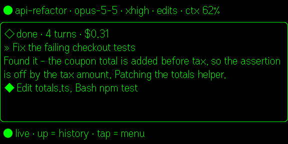
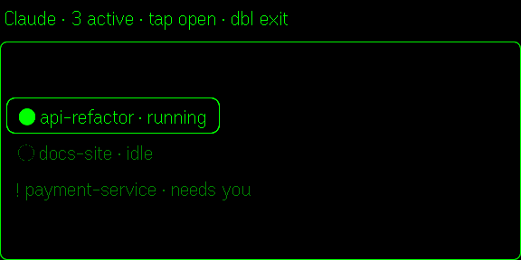
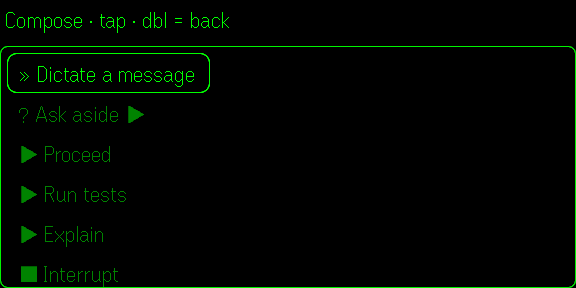
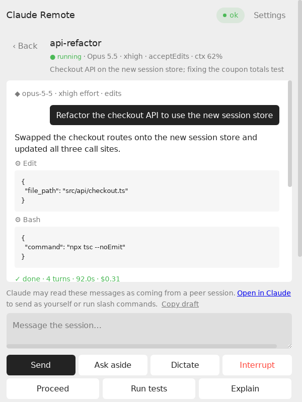

# Claude Remote

Monitor and control [Claude Code](https://code.claude.com/docs) remote-control
sessions from [Even Realities G2](https://www.evenrealities.com) glasses. Read
session output, answer permission requests, and dictate replies. A companion
phone panel provides the same controls and a detailed event log.

<p align="center">
  
</p>

> [!NOTE]
> Parts of this project are AI-generated. The code has been reviewed and tested;
> use at your own discretion.

## Quick start

1. **Install the app** on your glasses from the
   [Even Hub](https://hub.evenrealities.com/landing?package_id=com.thatcrispytoast.clauderemote),
   or sideload `claude-remote-<version>.ehpk`.

2. **Run the bridge** on a machine logged in to Claude Code. With
   [uv](https://docs.astral.sh/uv/):

   ```bash
   uvx --from "git+https://github.com/ThatCrispyToast/g2-claude-remote#subdirectory=server" claude-remote-bridge
   ```

   The bridge prints its URLs and a bearer token. The token is a word passphrase
   generated on first run and saved to `~/.config/claude-remote/bridge-token`.

3. **Connect** by entering a URL reachable from your phone and the token in the
   panel's Settings card. For voice dictation, also add a
   [Deepgram](https://console.deepgram.com) key.

If the phone can't connect, open the bridge's port (default `8790`) in the host
firewall.

> [!CAUTION]
> Keep the bridge on a private LAN or Tailscale network. Anyone with the token
> can read and control every remote-control session of the logged-in account.

See [`server/README.md`](server/README.md) for bridge options and updates.

## What it does

- **Live output:** sessions open at the latest output and follow new events.
  Scroll up for history and down to resume following. Consecutive tool calls
  share a compact line, such as `◆ Read factory.py, Edit scene.yaml`.
- **Permissions and questions:** prompts appear on the glasses, with `! needs you`
  in the footer when you're on another screen. Prompts close when answered on
  another device or in the terminal.
- **Side questions:** use Ask aside to ask about a running session without
  interrupting it or adding to its transcript. Choose a preset question or
  dictate one, then ask follow-ups.
- **Session controls:** interrupt, change model, permission mode, or reasoning
  effort (up to `max`), run slash commands, and send preset or dictated replies.
  Menus show the current model, mode, and effort.
- **Session info:** view a status summary, context use, background tasks, plan
  usage, and uncommitted changes.
- **Session list:** shows active, connected sessions with claude.ai pins first.
  Pin or unpin from the menu. Each control action checks that the session is
  still active and connected.
- **Connection status:** the HUD shows `! offline` if the bridge or stream stops
  responding and resumes when the connection returns.

<p align="center">
  
  
</p>

## How it works

```
G2 glasses (576×288 HUD · touchpad · mic)
        │ BLE
        ▼
Even phone app - runs this app (glasses UI + companion panel)
        │ HTTP + SSE · bearer token · LAN / Tailscale
        ▼
claude-remote-bridge (server/) - wraps claude-rc-api
        │ your Claude Code OAuth login (~/.claude, or the macOS Keychain)
        ▼
Anthropic Remote Control API
```

The app (`src/`, packaged as an `.ehpk`) runs inside the Even phone app and uses
the glasses' native widgets. The bridge ([`server/`](server/README.md)) exposes
[`claude-rc-api`](https://github.com/ThatCrispyToast/claude-rc-api) over HTTP and
SSE. It uses the host's Claude Code login, handles token rotation, filters for
active sessions, and authenticates requests with a bearer token.

## Controls

| Screen | Scroll ↑ / ↓ | Tap | Double-tap |
|---|---|---|---|
| **Sessions list** | move selection | open session | open exit dialog |
| **Session view** | up for history, down to live | open Compose menu | back to list |
| **Compose menu** | move selection | run action / open submenu | back to session |
| **Commands submenu** | move selection | run slash command | back to Compose |
| **Ask aside submenu** | move selection | ask question / start dictation | back to Compose |
| **Aside answer** | scroll the answer | ask a follow-up | back to session |
| **Session info** | scroll | refresh | back to session |
| **Model / Mode / Effort submenu** | move selection | apply | back to Compose |
| **Voice dictation** | scroll transcript | finish and review | cancel |
| **Confirm send** | scroll the message | send | cancel |
| **Permission prompt** | move between Allow / Deny | select | set aside |
| **Question** | move between options | select (`Dismiss` cancels) | set aside |

Compose contains dictation, Ask aside, configurable replies (`Proceed`, `Run
tests`, `Explain`), session controls, pinning, and archiving. Side questions use
one model call and skip the send confirmation. Slash commands run locally at no
token cost; `/compact` and `/clear` require confirmation.

To reopen a prompt you've set aside, select `! Answer question` or
`! Review permission` in Compose, or reopen the session.

### Voice dictation

Dictation requires a Deepgram key in Settings and defaults to English. Set a
[Deepgram language code](https://developers.deepgram.com/docs/models-languages-overview)
such as `de` or `pt-BR`, or use `multi` for mixed-language speech. Leaving the key
blank disables dictation.

The glasses' font supports Latin-1. Characters outside that range, including
French `œ` and `€`, may not display, but the full message is still sent.

## Companion panel

The phone panel provides all session controls and settings, plus a full event
log with tool inputs, usage, and cost. It supports typed messages, slash-command
autocomplete, side questions, and stopping background tasks. It also works in a
browser without glasses.

Release notices ship with app updates and appear above the session list and on
the glasses after connecting. Tap to dismiss a notice on both displays, or
double-tap on the glasses to defer it until the next launch. Dismissals are saved
on the device.

<p align="center">
  
</p>

## Configuration

1. **Settings card:** bridge URL, token, Deepgram key, and dictation language.
   Values persist on the device and override development defaults. Use this to
   configure an installed `.ehpk`.
2. **Development defaults:** `VITE_*` variables in `.env.local`, used by
   `npm run dev`. See [`.env.example`](.env.example) for the full list.
   Packaged builds exclude these values, including keys and host addresses.

The bridge accepts CLI flags, `RC_BRIDGE_*` environment variables, and
`.env.local`. It also accepts `VITE_BRIDGE_TOKEN`, so the app and bridge can share
a token in development.

## Development

Requires Node 18+ for the app and Python 3.10+ with
[uv](https://docs.astral.sh/uv/) for the bridge.

```bash
git clone https://github.com/ThatCrispyToast/g2-claude-remote && cd g2-claude-remote
npm install
cp .env.example .env.local     # set VITE_BRIDGE_URL / VITE_BRIDGE_TOKEN

npm run bridge                 # bridge → 0.0.0.0:8790
npm run dev                    # app dev server → http://0.0.0.0:5175

# sideload onto the glasses (phone on the same Wi-Fi / Tailscale network)
npx @evenrealities/evenhub-cli qr --url http://<host>:5175 --external
```

Set `VITE_BRIDGE_URL` to a Tailscale MagicDNS name or LAN IP the phone can reach.
To develop `claude-rc-api` alongside this app, clone it next to this repository
and use `npm run bridge:uv`.

**Packaging:** `npm run pack` creates `claude-remote-<version>.ehpk`. The versions
in `package.json` and `app.json` must match; update both when releasing.

**Bridge as a service:** install the bridge, then configure your service manager
to run `claude-remote-bridge`:

```bash
uv tool install "git+https://github.com/ThatCrispyToast/g2-claude-remote#subdirectory=server"
```

## License

[MIT](LICENSE). This project is not affiliated with Anthropic or Even Realities.
The Remote Control API is reverse-engineered and may change without notice.
